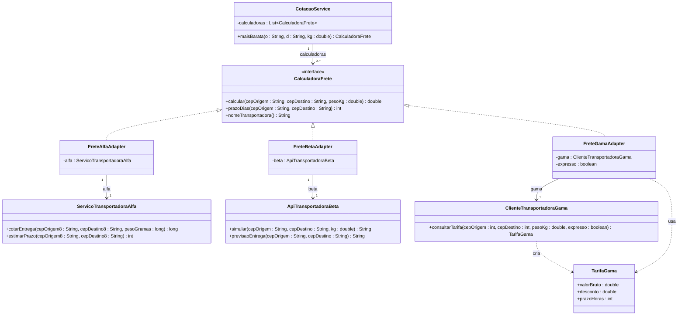

# Adapter — Referência rápida

**Categoria:** estrutural (GoF). Também conhecido como **Wrapper**.
**Intenção:** **converter a interface** de uma classe na interface que o cliente espera. Permite que classes com interfaces incompatíveis trabalhem juntas.
**Fontes:** GAMMA et al. (1994); slides do Prof. Escobar; gabarito da atividade do marketplace; REFACTORING.GURU, *Adapter*.

---

## 1. Participantes (nomes GoF — usar exatamente estes)

| Papel | Responsabilidade | Na atividade do marketplace |
|---|---|---|
| **Client** | Usa objetos **somente pelo Target** | `CotacaoService` |
| **Target** | Interface que o cliente espera | `CalculadoraFrete` |
| **Adapter** | Implementa o Target e **traduz** cada chamada para o Adaptee | `FreteAlfaAdapter`, `FreteBetaAdapter`, `FreteGamaAdapter` |
| **Adaptee** | Classe existente com interface incompatível; **não pode ser alterada** | `ServicoTransportadoraAlfa`, `ApiTransportadoraBeta`, `ClienteTransportadoraGama` |

> O quarto participante é o **Client**. Não existe "ConcreteTarget".

---

## 2. Fluxo de execução

1. O cliente cria o Adaptee e o entrega ao Adapter **pelo construtor**.
2. O cliente guarda o Adapter como `CalculadoraFrete` (Target).
3. O cliente chama `calcular(cepOrigem, cepDestino, pesoKg)`.
4. O Adapter **converte a entrada** (CEP, unidade de peso), chama o método do Adaptee e **converte a saída** (centavos, texto, `TarifaGama`) para `double` em reais.
5. O cliente recebe o resultado no formato do Target, sem saber qual fornecedor respondeu.

---

## 3. Adaptador de objeto vs adaptador de classe

| | **De objeto** (usado na atividade) | **De classe** |
|---|---|---|
| Mecanismo | **Composição**: guarda referência ao Adaptee | **Herança**: `extends Adaptee implements Target` |
| Relação com Adaptee | **Associação** (sólida, seta aberta), multiplicidade `1` | **Generalização** (sólida, triângulo vazado) |
| Relação com Target | **Realização** | **Realização** |
| Adapta subclasses do Adaptee? | **Sim**, recebe qualquer instância | **Não**, fica preso a uma classe |
| Expõe métodos do Adaptee? | Não | Sim, todos os públicos, por herança |
| Em Java | Sempre possível | Só se o Target for **interface**, porque Java não tem herança múltipla de classes |

**Resposta discursiva (≤ 5 linhas):** a solução usa composição porque o Java não permite herança múltipla de classes; com herança, cada Adapter ficaria preso a um único Adaptee concreto e exporia todos os métodos dele ao cliente. A composição permite injetar o Adaptee pelo construtor, trocá-lo e adaptar também suas subclasses, mantendo o cliente dependente apenas do Target.

---

## 4. Diagrama de classes (UML) — adaptador de objeto



### Relações e notação

| Relação | Entre | Notação | Multiplicidade |
|---|---|---|---|
| **Realização** | Adapter → Target (interface) | linha **tracejada**, triângulo **vazado** | — |
| **Associação** | Adapter → Adaptee | linha **sólida**, seta **aberta** | `1` |
| **Associação** | Client → Target | linha **sólida**, seta **aberta** | `0..*` (lista de cotações) |
| **Dependência** | Gama Adapter → `TarifaGama` | linha **tracejada**, seta **aberta** | — |

- O Client **nunca** se liga ao Adaptee nem ao Adapter concreto, só ao Target.

---

## 5. Conversões de cada Adapter (gabarito)

| Adapter | Entrada (Target → Adaptee) | Saída (Adaptee → Target) |
|---|---|---|
| **Alfa** | remover hífen do CEP; `Math.round(pesoKg * 1000)` → gramas | centavos `/ 100.0` → reais |
| **Beta** | CEP já com hífen (repassa) | `"R$ 36,15"` → remover `R$`, `trim`, `,` → `.`, `parseDouble`; `"5 dias uteis"` → extrair o número |
| **Gama** | validar 8 dígitos na **String**, depois `Integer.parseInt` | `valorBruto × (1 − desconto)`; `Math.ceil(prazoHoras / 24.0)` |

**Saída esperada (2,5 kg, 80010-000 → 01310-100):** Alfa R$ 34,00 (6 dias); Beta R$ 36,15 (5 dias); Gama R$ 30,00 (3 dias); Gama Expresso R$ 48,00 (1 dia). **Mais barata: Gama.**

---

## 6. Esqueleto Java

```java
public interface FreightCalculator {
    double calculate(String originZip, String destinationZip, double weightKg);
    int deadlineDays(String originZip, String destinationZip);
    String carrierName();
}

public class BetaFreightAdapter implements FreightCalculator {
    private final BetaCarrierApi beta;                 // composição

    public BetaFreightAdapter(BetaCarrierApi beta) {   // Adaptee injetado
        this.beta = beta;
    }

    @Override
    public double calculate(String originZip, String destinationZip, double weightKg) {
        String raw = beta.simulate(originZip, destinationZip, weightKg); // "R$ 36,15"
        String normalized = raw.replace("R$", "").trim()
                               .replace(".", "")       // separador de milhar
                               .replace(",", ".");
        return Double.parseDouble(normalized);
    }

    @Override
    public int deadlineDays(String originZip, String destinationZip) {
        String raw = beta.deliveryForecast(originZip, destinationZip); // "5 dias uteis"
        return Integer.parseInt(raw.replaceAll("\\D+", ""));
    }

    @Override
    public String carrierName() { return "Beta"; }
}

public class GamaFreightAdapter implements FreightCalculator {
    private final GamaCarrierClient gama;
    private final boolean express;

    public GamaFreightAdapter(GamaCarrierClient gama, boolean express) {
        this.gama = gama;
        this.express = express;
    }

    private int toZipInt(String zip) {
        String digits = zip.replace("-", "");
        if (!digits.matches("\\d{8}")) {               // valida ANTES de virar int
            throw new IllegalArgumentException("CEP inválido: " + zip);
        }
        return Integer.parseInt(digits);
    }

    @Override
    public double calculate(String originZip, String destinationZip, double weightKg) {
        GamaRate rate = gama.queryRate(toZipInt(originZip), toZipInt(destinationZip), weightKg, express);
        return rate.getGrossValue() * (1 - rate.getDiscount());
    }

    @Override
    public int deadlineDays(String originZip, String destinationZip) {
        GamaRate rate = gama.queryRate(toZipInt(originZip), toZipInt(destinationZip), 1.0, express);
        return (int) Math.ceil(rate.getDeadlineHours() / 24.0);
    }

    @Override
    public String carrierName() { return express ? "Gama Expresso" : "Gama"; }
}
```

---

## 7. Armadilhas de prova

- **Divisão inteira:** `centavos / 100` e `horas / 24` truncam. Use `100.0` e `24.0`.
- **CEP como `int` perde o zero à esquerda:** `01310100` vira `1310100`. Valide os 8 dígitos na **String**, antes do `parseInt`.
- **Conversão nunca fica no Client:** se ficasse no `CotacaoService`, ele conheceria cada fornecedor e precisaria de um `if` por transportadora (viola OCP e SRP; o enunciado proíbe alterar o checkout).
- **Extensão sem modificação:** incluir a Gama = criar `FreteGamaAdapter` e registrá-lo no `Main`. Nenhuma classe existente muda.
- **Slide do Escobar:** o comentário diz "converte valor para dólar", mas o código passa `"BRL"`. O comentário está inconsistente com o código.
- **Adapter vs vizinhos:**
  - **Adapter** muda a interface de **um** objeto existente.
  - **Decorator** mantém a **mesma** interface e acrescenta comportamento.
  - **Facade** cria uma interface **simplificada** para um **subsistema** inteiro.
  - **Strategy** varia o algoritmo; as classes já nascem no contrato.
- **Consequências (GoF):** o adaptador de objeto deixa um Adapter trabalhar com o Adaptee e todas as suas subclasses; o adaptador de classe pode sobrescrever comportamento do Adaptee, mas não adapta subclasses.
