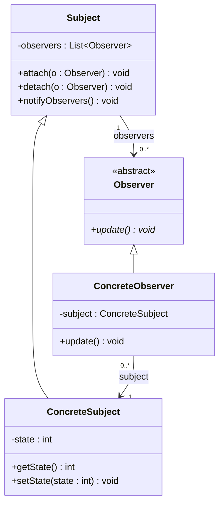

# Observer — Referência rápida

**Categoria:** comportamental (GoF)
**Intenção:** definir uma dependência um-para-muitos entre objetos; quando um objeto muda de estado, todos os seus dependentes são notificados e atualizados automaticamente.
**Fontes:** GAMMA et al. (1994); slides do Prof. Escobar; FREEMAN & ROBSON, Head First (2020).

---

## 1. Participantes (nomes GoF — usar exatamente estes)

| Papel | Responsabilidade | Membros principais |
|---|---|---|
| **Subject** | Conhece seus observadores e fornece a interface para registrá-los/removê-los. Implementa a lógica de registro **uma única vez**. | `- observers : List<Observer>`, `+ attach(o)`, `+ detach(o)`, `+ notifyObservers()` |
| **ConcreteSubject** | Guarda o estado de interesse e notifica quando ele muda. | `- state`, `+ getState()`, `+ setState(s)` |
| **Observer** | Define a interface de atualização. | `+ update()` (abstrato) |
| **ConcreteObserver** | Mantém referência ao ConcreteSubject e reage à notificação, lendo o estado dele. | `- subject : ConcreteSubject`, `+ update()` |

> **Não confundir:** "Product / ConcreteProduct" são nomes do **Factory Method / Abstract Factory**, não do Observer.

---

## 2. Fluxo de execução

1. `ConcreteObserver` é criado recebendo o `Subject` e chama `subject.attach(this)`.
2. Cliente chama `subject.setState(x)`.
3. `setState` chama `notifyObservers()`.
4. `notifyObservers()` percorre a lista e chama `update()` em cada observador.
5. Cada `update()` chama `subject.getState()` para ler o novo valor.

### Quem dispara o `notify`? (trade-off — GoF, Implementation)
- **Setter dispara automaticamente** (slide do Escobar): nunca se esquece de notificar; porém várias alterações seguidas geram várias notificações.
- **Cliente chama `notify` manualmente:** permite agrupar alterações; porém é fácil esquecer.

### Push vs Pull
- **Pull** (slide/GoF padrão): `update()` sem parâmetros; o observador busca o estado via `getState()`. Exige a referência ao Subject.
- **Push:** `update(estado)` envia os dados; o observador não precisa da referência, mas o Subject passa a assumir o que cada observador precisa.

---

## 3. Diagrama de classes (UML)



### Relações e notação

| Relação | Entre | Notação | Multiplicidade |
|---|---|---|---|
| **Generalização** (herança) | ConcreteSubject → Subject; ConcreteObserver → Observer (classe abstrata) | linha **sólida**, ponta **triangular vazada** | — |
| **Realização** (implements) | ConcreteObserver → Observer, **se Observer for interface** | linha **tracejada**, ponta **triangular vazada** | — |
| **Associação** | Subject → Observer | linha **sólida**, seta **aberta** | `0..*` do lado do Observer |
| **Associação inversa** | ConcreteObserver → ConcreteSubject | linha **sólida**, seta **aberta** | `1` do lado do Subject |

- Multiplicidade é **`0..*`**, não `1..*`: o Subject existe sem observadores (a lista começa vazia).
- Classe/método abstrato: nome em *itálico* ou estereótipo `<<abstract>>`. Interface: `<<interface>>`.

---

## 4. Esqueleto Java (pull, notificação no setter)

```java
public class Subject {
    private final List<Observer> observers = new ArrayList<>();

    public void attach(Observer o) { observers.add(o); }
    public void detach(Observer o) { observers.remove(o); }

    protected void notifyObservers() {
        for (Observer o : observers) {
            o.update();
        }
    }
}

public class ConcreteSubject extends Subject {
    private int state;

    public int getState() { return state; }

    public void setState(int state) {
        this.state = state;
        notifyObservers();
    }
}

public abstract class Observer {
    public abstract void update();
}

public class ConcreteObserver extends Observer {
    private final ConcreteSubject subject;

    public ConcreteObserver(ConcreteSubject subject) {
        this.subject = subject;
        this.subject.attach(this);
    }

    @Override
    public void update() {
        System.out.println("Novo estado: " + subject.getState());
    }
}
```

---

## 5. Armadilhas de prova

- **Não nomear o método `notify()` em Java:** `Object.notify()` é `final`; declarar `public void notify()` não compila. Use `notifyObservers()` / `notifyAllObservers()`.
- **Interface não tem atributo de instância:** se `Subject` for `interface`, a `List<Observer>` vai no ConcreteSubject (variante Head First). Se a lista estiver em `Subject`, ele é classe (variante GoF/slide).
- No **slide do Escobar**, `Subject` é concreta e já acumula o estado (`getState/setState`) — funde Subject e ConcreteSubject. O GoF separa os dois.
- No slide, `Observer` é **classe abstrata** com `protected Subject subject` → relação com ConcreteObserver é **generalização**, não realização.
- Benefício central: **baixo acoplamento** — o Subject só conhece a abstração `Observer`, nunca as classes concretas (Aberto/Fechado).
- Risco: notificações em cascata e atualizações inesperadas; observador não removido com `detach` vira vazamento de memória (*lapsed listener*).
