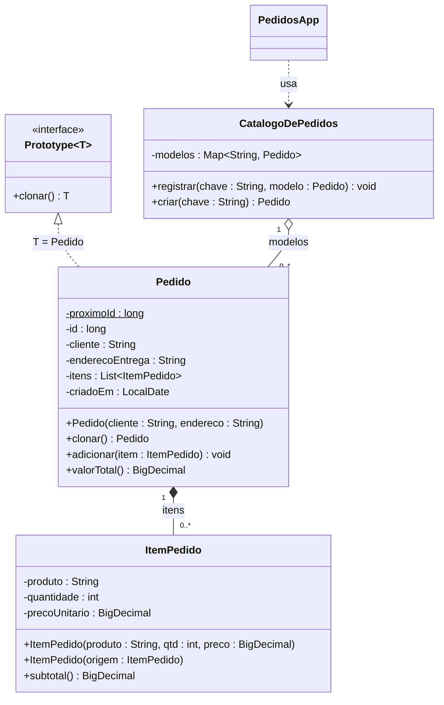

# Prototype — Referência rápida

**Categoria:** criacional (GoF)
**Intenção:** criar novos objetos **copiando uma instância existente** (o protótipo), em vez de instanciar a classe diretamente. O próprio objeto sabe se copiar.
**Fontes:** GAMMA et al. (1994); slides do Prof. Escobar; BLOCH, *Effective Java*, 3. ed. (2018), Item 13; REFACTORING.GURU, *Prototype*.

---

## 1. Participantes (nomes GoF — usar exatamente estes)

| Papel | Responsabilidade | Slide (contratos) | Atividade (pedidos) |
|---|---|---|---|
| **Prototype** | Interface que declara a operação de clonagem | `Prototype<T>` | `Prototype<T>` (`T clonar()`) |
| **ConcretePrototype** | Implementa a clonagem copiando o próprio estado | `Contrato` | `Pedido` |
| **Client** | Pede cópias ao protótipo; não conhece a classe concreta | `PrototypeDemo` | `PedidosApp` |
| **Registry** (opcional; GoF: *prototype manager*) | Catálogo de protótipos por chave; devolve **sempre uma cópia** | `ModeloRegistry` | `CatalogoDePedidos` |

> `Clausula` / `ItemPedido` **não são** ConcretePrototypes. São objetos agregados que oferecem **construtor de cópia** para viabilizar a cópia profunda.

---

## 2. Fluxo de execução

1. O cliente monta um modelo (`Pedido` com 3 itens) e o registra: `catalogo.registrar("reposicao-mensal", modelo)`.
2. O cliente pede `catalogo.criar("reposicao-mensal")`.
3. O Registry busca o modelo e devolve `modelo.clonar()`, **nunca o próprio modelo**.
4. `clonar()` cria um novo `Pedido`, copia `cliente`/`endereco`, cria **nova lista** com **novos `ItemPedido`**, gera **novo id** e **nova data**.
5. O cliente ajusta só a cópia (cliente, endereço, itens).

---

## 3. Cópia rasa vs cópia profunda

| | **Rasa** | **Profunda** |
|---|---|---|
| Lista `itens` | mesma referência | **nova** lista |
| Cada `ItemPedido` | mesma instância | **nova** instância (construtor de cópia) |
| Alterar item na cópia | **altera o modelo** e as demais cópias | modelo intacto |
| Java padrão | `Object.clone()` | manual (construtor/fábrica de cópia) ou serialização |

### O que pode ser copiado por referência
- Objetos **imutáveis**: `String`, `BigDecimal`, `LocalDate`. Compartilhar não causa efeito colateral.
- Objetos **mutáveis** (`List`, `ItemPedido`) **precisam** de cópia própria.

### Efeito nos critérios de aceitação (cenário da atividade)

| Implementação de `clonar()` | CA-02 (modelo = 315) | CA-04 (modelo com 3 itens) | CA-05 (itens ≠ instâncias do modelo) |
|---|---|---|---|
| Copia só a referência da lista | **FALHA** (B altera o Café do modelo) | **FALHA** (Adoçante de C entra no modelo) | **FALHA** |
| Nova lista, **mesmos** itens (`new ArrayList<>(itens)`) | **FALHA** (item compartilhado) | OK | **FALHA** |
| Nova lista + `new ItemPedido(item)` | OK | OK | OK |

> Com itens compartilhados, C é clonado de um modelo já corrompido por B: C sairia com total R$ 576,00 em vez de R$ 387,00.

---

## 4. Diagrama de classes (UML)



### Relações e notação

| Relação | Entre | Notação | Multiplicidade |
|---|---|---|---|
| **Realização** com *binding* `T → Pedido` | `Pedido` → `Prototype<T>` | linha **tracejada**, triângulo **vazado** | — |
| **Composição** | `Pedido` ◆— `ItemPedido` | linha **sólida**, losango **cheio** do lado do `Pedido` | `1` — `0..*` |
| **Agregação** (ou associação) | `CatalogoDePedidos` ◇— `Pedido` | linha **sólida**, losango **vazado** do lado do catálogo | `1` — `0..*` (ou qualificador `chave : String`) |
| **Dependência** | `PedidosApp` → `CatalogoDePedidos` | linha **tracejada**, seta **aberta** | — |

- **Composição** se justifica porque cada `ItemPedido` pertence a um único pedido e não é compartilhado. É isso que a cópia profunda garante [Likely: o slide usa o termo "agregado"; se a prova seguir o slide, use **losango vazado**].
- Atributo `static` (`proximoId`) vai **sublinhado** (no Mermaid, `$`).
- Construtor de cópia `ItemPedido(origem : ItemPedido)` aparece como **segundo construtor** na classe.

---

## 5. Esqueleto Java

```java
public interface Prototype<T> {
    T copy();
}

public class OrderItem {
    private final String product;
    private int quantity;
    private final BigDecimal unitPrice;

    public OrderItem(String product, int quantity, BigDecimal unitPrice) {
        this.product = product;
        this.quantity = quantity;
        this.unitPrice = unitPrice;
    }

    public OrderItem(OrderItem origin) {             // construtor de cópia
        this(origin.product, origin.quantity, origin.unitPrice); // BigDecimal é imutável
    }

    public BigDecimal subtotal() {
        return unitPrice.multiply(BigDecimal.valueOf(quantity));
    }

    public void setQuantity(int quantity) { this.quantity = quantity; }
}

public class Order implements Prototype<Order> {
    private static long nextId = 1;                  // RF05: id sequencial

    private final long id;
    private String customer;
    private String address;
    private final List<OrderItem> items = new ArrayList<>();
    private final LocalDate createdAt;

    public Order(String customer, String address) {
        this.id = nextId++;
        this.customer = customer;
        this.address = address;
        this.createdAt = LocalDate.now();
    }

    @Override
    public Order copy() {
        Order clone = new Order(this.customer, this.address); // novo id e nova data (RF07)
        for (OrderItem item : this.items) {
            clone.items.add(new OrderItem(item));    // cópia profunda (RF06)
        }
        return clone;
    }

    public BigDecimal total() {
        return items.stream()
                    .map(OrderItem::subtotal)
                    .reduce(BigDecimal.ZERO, BigDecimal::add)
                    .setScale(2, RoundingMode.HALF_UP);
    }
}

public class OrderCatalog {
    private final Map<String, Order> templates = new HashMap<>();

    public void register(String key, Order template) {
        templates.put(key, template);
    }

    public Order create(String key) {
        Order template = templates.get(key);
        if (template == null) {                      // RF09
            throw new IllegalArgumentException("Chave não registrada: " + key);
        }
        return template.copy();                      // nunca o original (RF08)
    }
}
```

---

## 6. Armadilhas de prova

- **`Object.clone()` faz cópia rasa.** A atividade proíbe `Cloneable`/`clone()` (RT04). Bloch (Item 13) recomenda construtor ou fábrica de cópia.
- **`Cloneable` é interface marcadora:** não declara `clone()`. Por isso o projeto dela é considerado problemático.
- **Nova lista com os mesmos itens ainda é rasa** no nível dos itens: CA-04 passa, mas CA-02 e CA-05 falham.
- **Identidade não se copia:** `id` e `criadoEm` são gerados de novo na cópia (RF07). Com campo `final`, isso só funciona se a cópia passar por um construtor.
- **Registry devolve cópia, nunca o modelo:** devolver o original faz o cliente alterar o protótipo.
- **Chave inexistente:** `Map.get` devolve `null`; sem a checagem, `null.clonar()` vira `NullPointerException` em vez da `IllegalArgumentException` exigida.
- **Dinheiro em `BigDecimal`** (RT03): `double` invalida o requisito. Totais com `setScale(2, RoundingMode.HALF_UP)`.
- **Clonagem por serialização (RF12):** cópia profunda automática, porém mais lenta e exige `Serializable` em todas as classes do grafo. Depois de desserializar, ainda é preciso **gerar novo id e data**.
- **Referências circulares** tornam a cópia profunda manual difícil.
- **Relação com outros padrões (GoF):**
  - **Factory Method** varia o produto por herança (hierarquia de criadores); o Prototype dispensa essa hierarquia.
  - **Abstract Factory** pode ser implementada guardando protótipos e devolvendo cópias.
  - O **Registry** costuma ser **Singleton**.
  - Projetos com muito **Composite** e **Decorator** se beneficiam do Prototype.
