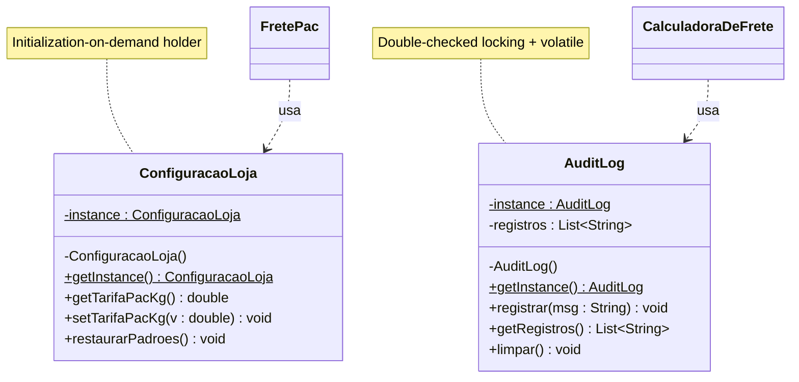

# Singleton — Referência rápida

**Categoria:** criacional (GoF)
**Intenção:** garantir que uma classe tenha **uma única instância** e fornecer um **ponto de acesso global** a ela.
**Fontes:** GAMMA et al. (1994); slides do Prof. Escobar; BLOCH, *Effective Java*, 3. ed. (2018), Itens 3 e 83; GOETZ, *Java Concurrency in Practice* (2006), §16.2; JLS §12.4.2.

---

## 1. Participantes e elementos obrigatórios

O GoF tem um único participante: **Singleton**. A estrutura dele tem três elementos obrigatórios.

| Elemento | Acesso | `static`? | Função |
|---|---|---|---|
| `instance` | `private` | **sim** | Guarda a única instância |
| `Singleton()` | `private` | **não** (construtor nunca é static) | Impede `new` fora da classe |
| `getInstance()` | `public` | **sim** | Cria a instância na primeira chamada e devolve sempre a mesma |

**Cliente:** qualquer classe que chame `Singleton.getInstance()`. Ela não guarda a instância como atributo, só a usa.

---

## 2. Diagrama de classes (UML)



### Notação

| Elemento | Como representar |
|---|---|
| Membro `static` | **sublinhado** (no Mermaid, `$` no fim) |
| Construtor privado | `- Singleton()`: **sem parâmetro e sem tipo de retorno** |
| `instance` | `- instance : Singleton` (sublinhado) |
| `getInstance` | `+ getInstance() : Singleton` (sublinhado) |
| Cliente que chama `getInstance()` | **Dependência**: linha **tracejada**, seta **aberta** (o cliente usa, não guarda) |
| Técnica de criação | **Nota** (retângulo com canto dobrado) ligada à classe por linha tracejada |

> Uma autoassociação `Singleton → Singleton` com multiplicidade `1` é opcional. O GoF representa só o atributo static.

---

## 3. Técnicas de criação em Java

| Técnica | Lazy? | Thread-safe? | Observação |
|---|---|---|---|
| **Eager** (`static final instance = new X()`) | não | sim | Mais simples; instancia ao carregar a classe |
| **Lazy ingênuo** (`if (instance == null)`) | sim | **não** | Duas threads podem criar duas instâncias |
| **`synchronized` no método** | sim | sim | Paga o lock em **toda** chamada |
| **Double-checked locking + `volatile`** | sim | sim | Lock só na primeira criação |
| **Initialization-on-demand holder** | sim | sim | A JVM faz o lock na inicialização da classe |
| **`enum`** com um único valor | não | sim | Recomendado por Bloch (Item 3); imune a reflexão e serialização |

### Por que o DCL exige `volatile`
1. `instance = new X()` não é atômico: aloca memória, executa o construtor e atribui a referência.
2. O JIT ou a CPU podem **reordenar** os passos e atribuir a referência antes do construtor terminar.
3. Outra thread faz a 1ª checagem (fora do lock), vê `instance != null` e usa um objeto **construído pela metade**.
4. O `volatile` proíbe essa reordenação e garante visibilidade entre threads (*happens-before*, JMM/JSR-133).

### Por que o holder dispensa o `synchronized`
- A instância fica como `static final` em uma **classe interna estática**.
- A JVM só inicializa uma classe no **primeiro uso**, por isso a criação é lazy.
- A JLS §12.4.2 garante que a inicialização de classe ocorre **uma única vez, sob lock interno da JVM**.

---

## 4. Esqueletos Java

```java
// Double-checked locking (AuditLog)
public final class AuditLog {
    private static volatile AuditLog instance; // não pode ser final: é atribuído depois
    private final List<String> records = Collections.synchronizedList(new ArrayList<>());

    private AuditLog() { }

    public static AuditLog getInstance() {
        if (instance == null) {                 // 1ª checagem, sem lock
            synchronized (AuditLog.class) {
                if (instance == null) {         // 2ª checagem, com lock
                    instance = new AuditLog();
                }
            }
        }
        return instance;
    }

    public void record(String message) { records.add(message); }

    public List<String> getRecords() {
        synchronized (records) {
            return List.copyOf(records);        // cópia imutável, mantém a ordem
        }
    }

    public void clear() { records.clear(); }
}
```

```java
// Initialization-on-demand holder (ConfiguracaoLoja)
public final class StoreConfig {
    private StoreConfig() { }

    private static class Holder {
        private static final StoreConfig INSTANCE = new StoreConfig();
    }

    public static StoreConfig getInstance() {
        return Holder.INSTANCE;                 // 1º acesso dispara a inicialização do Holder
    }
}
```

```javascript
// Node.js: impedir 2ª instância mesmo com `new` direto (exigência da atividade)
class AuditLog {
    static #instance = null;

    constructor() {
        if (AuditLog.#instance) {
            throw new Error("Use AuditLog.getInstance()");
        }
        AuditLog.#instance = this;
    }

    static getInstance() {
        return AuditLog.#instance ?? new AuditLog();
    }
}
```

---

## 5. Armadilhas de prova

- **`final` + lazy não combinam:** `final` só funciona em eager ou no holder.
- **O construtor não é static** e **não recebe a própria classe**. `Singleton(Singleton s)` é construtor de cópia, recurso do **Prototype**.
- **Instância segura ≠ estado seguro:** o DCL e o holder só protegem a *criação*. Métodos que alteram estado (como `registrar`) precisam de estrutura sincronizada.
- **`getRegistros()` não pode expor a lista interna:** devolva `List.copyOf` ou `Collections.unmodifiableList`.
- **Estratégias não guardam cópia das tarifas:** chamam `ConfiguracaoLoja.getInstance()` a cada cálculo (exigência da atividade).
- **Quebras do Singleton em Java:** reflexão (`setAccessible(true)`), serialização (exige `readResolve()`) e `clone()`. O `enum` resolve as duas primeiras.
- **Desvantagens (slide):** dificulta testes, porque o estado persiste entre eles; tende a violar SRP; é estado global e acopla o cliente à classe concreta (fere DIP).
- **Relação com outros padrões:** o registry do Prototype e as fábricas concretas do Abstract Factory costumam ser Singletons (GoF).
