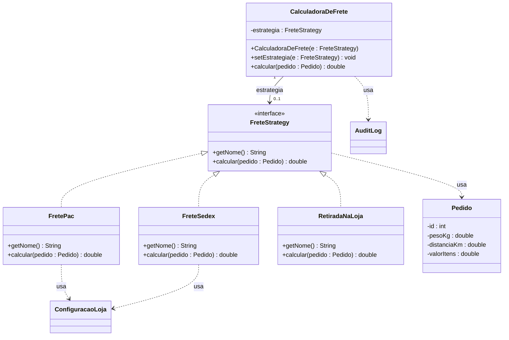

# Strategy — Referência rápida

**Categoria:** comportamental (GoF)
**Intenção:** definir uma **família de algoritmos**, encapsular cada um e torná-los **intercambiáveis**. O algoritmo varia independentemente dos clientes que o usam.
**Fontes:** GAMMA et al. (1994); slides do Prof. Escobar; FREEMAN & ROBSON, Head First (2020).

---

## 1. Participantes (nomes GoF — usar exatamente estes)

| Papel | Responsabilidade | Na atividade da loja |
|---|---|---|
| **Strategy** | Interface comum a todos os algoritmos | `FreteStrategy` (`getNome()`, `calcular(pedido)`) |
| **ConcreteStrategy** | Implementa um algoritmo específico | `FretePac`, `FreteSedex`, `RetiradaNaLoja` |
| **Context** | Guarda uma referência à Strategy e **delega** a ela. Conhece só a abstração. | `CalculadoraDeFrete` |
| **Client** (fora dos 3 do GoF) | **Escolhe** a ConcreteStrategy e a injeta no Context | `Main` |

> O Context **não conhece nem lista** as estratégias concretas. Quem conhece é o cliente.

---

## 2. Fluxo de execução

1. O cliente instancia uma ConcreteStrategy (`new FretePac()`).
2. Injeta no Context pelo construtor ou por `setEstrategia(...)`.
3. O cliente chama `context.calcular(pedido)`.
4. O Context delega: `estrategia.calcular(pedido)`.
5. Para trocar o comportamento em tempo de execução, basta chamar `setEstrategia(outra)`. Nenhum `if` envolvido.

### Como a Strategy acessa os dados? (trade-off — GoF, Implementation)
- **Context passa os dados como parâmetro** (`calcular(pedido)`): baixo acoplamento, mas pode passar dados que a estratégia não usa.
- **Context passa a si mesmo** (`calcular(this)`): a estratégia busca o que precisa, mas fica acoplada ao Context.

---

## 3. Diagrama de classes (UML)



### Relações e notação

| Relação | Entre | Notação | Multiplicidade |
|---|---|---|---|
| **Realização** (implements) | ConcreteStrategy → Strategy (interface) | linha **tracejada**, ponta **triangular vazada** | — |
| **Associação** (exigida pelo Escobar) | Context → Strategy | linha **sólida**, seta **aberta** | `0..1` (ou `1` se a estratégia for obrigatória) |
| *Agregação* (diagrama do GoF) | Context ◇→ Strategy | linha sólida, **losango vazado** do lado do Context | idem |
| **Dependência** | estratégias → Pedido, ConfiguracaoLoja; Context → AuditLog | linha **tracejada**, seta **aberta** | — |

- Multiplicidade **não** é `0..*`: o Context tem **uma** estratégia por vez.
- Dependência = usa como parâmetro ou chamada local (`getInstance()`); associação = guarda como atributo.

---

## 4. Esqueleto Java

```java
public interface ShippingStrategy {
    String getName();
    double calculate(Order order);
}

public class PacShipping implements ShippingStrategy {
    @Override
    public String getName() { return "PAC"; }

    @Override
    public double calculate(Order order) {
        StoreConfig cfg = StoreConfig.getInstance(); // consulta a cada cálculo, sem cópia
        return order.getWeightKg() * cfg.getPacPerKg()
             + order.getDistanceKm() * cfg.getPacPerKm();
    }
}

public class ShippingCalculator {
    private ShippingStrategy strategy;

    public ShippingCalculator() { }

    public ShippingCalculator(ShippingStrategy strategy) {
        this.strategy = strategy;
    }

    public void setStrategy(ShippingStrategy strategy) {
        this.strategy = strategy;
    }

    public double calculate(Order order) {
        if (strategy == null) {                       // valida estado, não decide tipo
            throw new IllegalStateException("Nenhuma estratégia definida");
        }
        double cost = strategy.calculate(order);      // delegação
        AuditLog.getInstance().record(String.format(Locale.US,
                "pedido=%d estrategia=%s frete=%.2f",
                order.getId(), strategy.getName(), cost));
        return cost;
    }
}
```

---

## 5. Armadilhas de prova

- **Princípios SOLID:** **OCP** (nova estratégia sem alterar o Context) e **DIP** (Context depende da abstração).
- O `if (strategy == null)` **é permitido**: ele valida estado. O proibido é `if`/`switch` sobre o **tipo** de frete.
- **`Locale.US` no `String.format`:** em máquina com locale pt-BR, `%.2f` gera `35,00` em vez de `35.00` e quebra o formato do log.
- O log é gravado **depois** do cálculo: se `calcular` lançar exceção, nada é gravado (requisito da atividade).
- **Strategy vs Adapter:** Strategy **varia o algoritmo** (as classes já nascem no contrato); Adapter **traduz uma interface incompatível** de algo que já existe.
- **Consequências (GoF):** elimina condicionais; o cliente **precisa conhecer** as estratégias para escolher; aumenta o número de objetos; estratégias sem estado podem ser compartilhadas.
- **Interface funcional:** com um único método abstrato, a Strategy pode ser passada como lambda. `FreteStrategy` tem dois métodos, então **não** é funcional.
- **Desafio `FreteGratisAcima`:** recebe outra `FreteStrategy` no construtor, implementa a mesma interface e delega condicionalmente. É o padrão **Decorator**.
